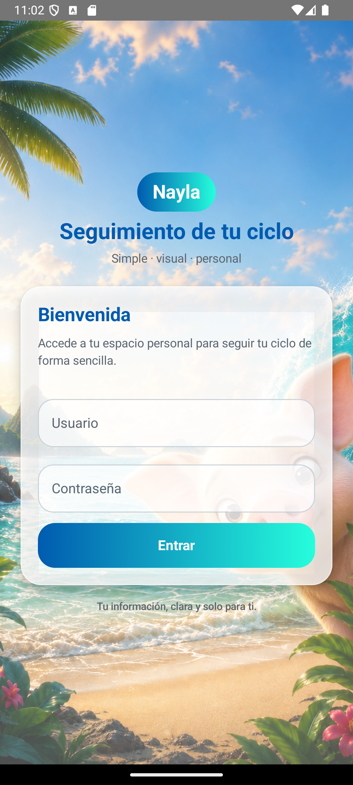
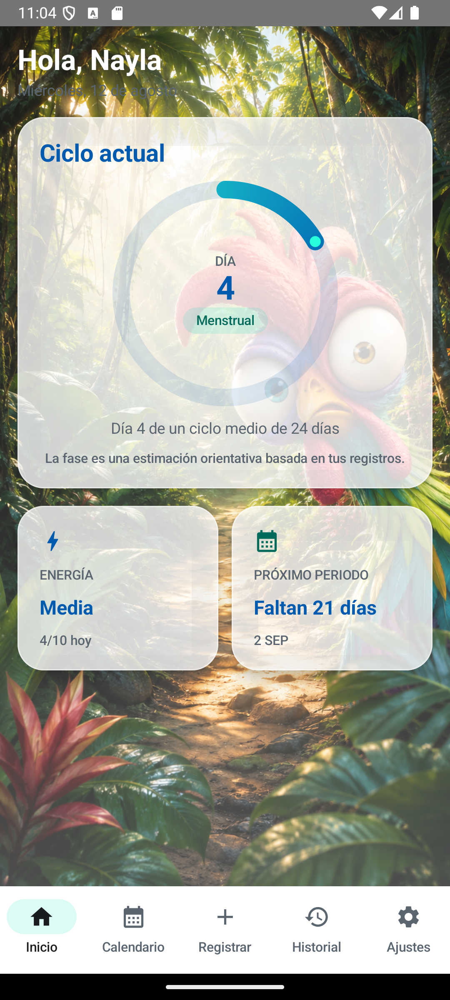
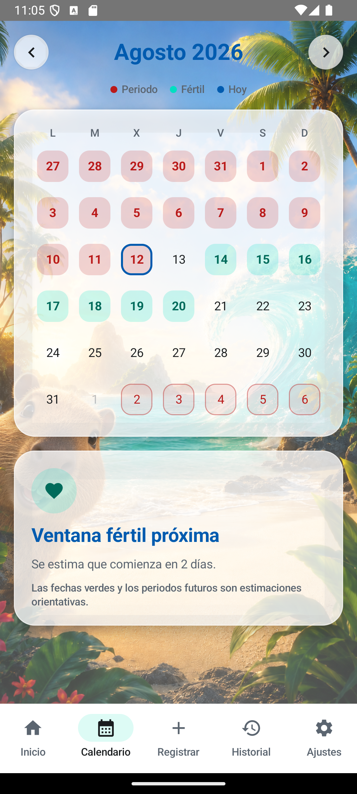
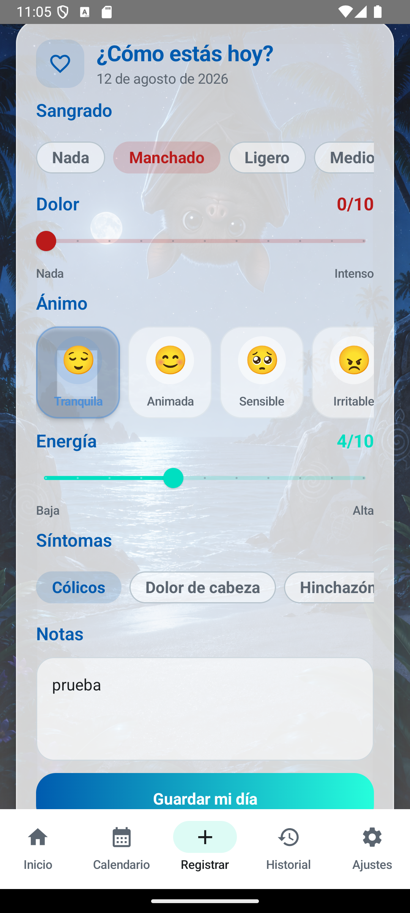
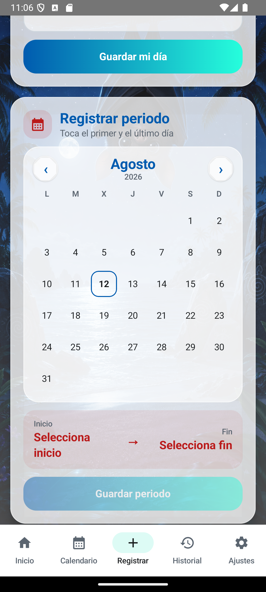
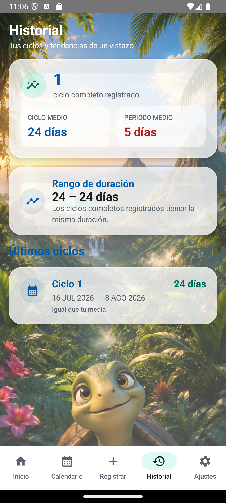
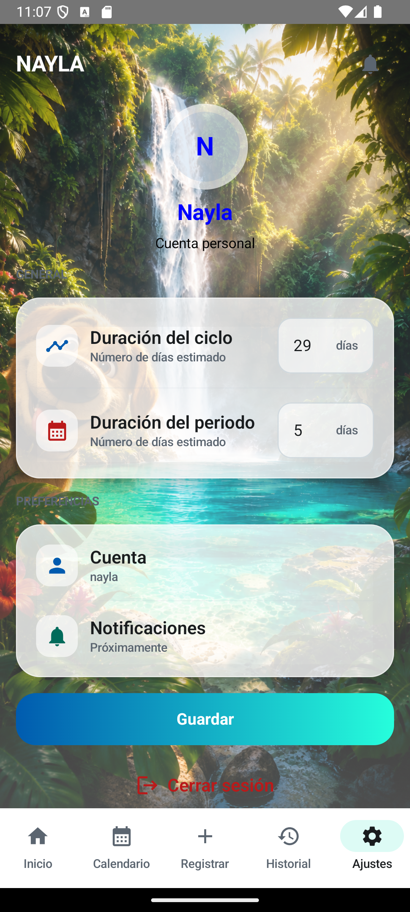

# NaylaP-Showcase
Aplicación multiplataforma para el seguimiento del ciclo menstrual, desarrollada con Kotlin Multiplatform, Compose Multiplatform y Supabase. Incluye funcionalidades, arquitectura y capturas de pantalla. Código fuente privado.

# NaylaPP — Kotlin Multiplatform Cycle Tracking App


## Overview

**NaylaPP** is a personal menstrual-cycle tracking application built with **Kotlin Multiplatform** and **Compose Multiplatform**.

The project was designed to provide a simple, visual and private way to register menstrual periods, daily wellness information and cycle-related observations while keeping the data model small, consistent and easy to maintain.

The Android version is already functional and has been packaged as an APK for real-device use. The same shared Kotlin codebase is prepared for an iOS target, which will be compiled and validated later using macOS and Xcode.

> One shared Kotlin codebase. Real Supabase backend. Row Level Security. Cross-platform UI. Personal wellness tracking.

---

## Why this project stands out

- Built with **Kotlin Multiplatform** instead of maintaining two completely separate mobile codebases
- Uses **Compose Multiplatform** for shared UI and design consistency
- Structured around **MVVM** and **Repository Pattern**
- Connected to a real backend using **Supabase** and **PostgreSQL**
- Uses **Supabase Auth** and **Row Level Security** to isolate user data
- Keeps Supabase as the **source of truth** instead of introducing unnecessary local-database complexity
- Separates real data from calculated predictions
- Includes a reusable visual design system with glassmorphism, shared components and per-screen backgrounds
- Already runs as a real Android application on a physical device
- Prepared for future iOS compilation without rewriting the product logic

---

## Tech Stack

| Area | Technologies |
|---|---|
| Cross-platform Mobile | Kotlin Multiplatform |
| UI | Compose Multiplatform, Material 3 |
| Architecture | MVVM, ViewModel, StateFlow, Repository Pattern |
| Backend | Supabase |
| Database | PostgreSQL |
| Authentication | Supabase Auth |
| Security | Row Level Security, authenticated-user policies |
| Date Handling | kotlinx-datetime |
| Resources | Compose Multiplatform Resources |
| Android Build | Gradle, APK |
| iOS Target | Kotlin/Native, Xcode integration |
| Version Control | Git, GitHub |

---

## App Screenshots

<table>
  <tr>
    <td width="50%" valign="top">
      <h3>Login</h3>
      
    </td>
    <td width="50%" valign="top">
      <h3>Home</h3>
      
    </td>
  </tr>
  <tr>
    <td width="50%" valign="top">
      <h3>Calendar</h3>
      
    </td>
    <td width="50%" valign="top">
      <h3>Register — Daily Log</h3>
      
    </td>
  </tr>
  <tr>
    <td width="50%" valign="top">
      <h3>Register — Period</h3>
      
    </td>
    <td width="50%" valign="top">
      <h3>History</h3>
      
    </td>
  </tr>
  <tr>
    <td width="50%" valign="top">
      <h3>Settings</h3>
      
    </td>
    <td width="50%" valign="top"></td>
  </tr>
</table>

---

## What NaylaPP is made for

NaylaPP is intentionally focused on a small and clear set of everyday actions:

1. **Record real menstrual periods** so the app has reliable historical data.
2. **Register daily wellness information** such as bleeding, pain, mood, energy, symptoms and notes.
3. **Calculate useful cycle summaries** from real records instead of manually maintaining predictions.
4. **Display estimated dates visually** in Home and Calendar without treating predictions as medical facts.
5. **Keep personal data protected** behind authentication and database-level access policies.

The product is designed as a personal wellness tracker, not as a medical diagnostic or contraceptive tool.

---

## How it works

```text
Compose Multiplatform UI
        ↓
ViewModel
        ↓
Repository
        ↓
Supabase Client
        ↓
Supabase Auth + PostgreSQL
        ↓
Row Level Security
```

The UI never talks directly to the database. Each screen communicates with its ViewModel, which delegates data operations to a repository.

Supabase stores the real records. Cycle predictions and summaries are calculated from those real records and are not treated as persisted source-of-truth data.

---

## Core Modules

### Authentication
The app provides a minimal username-and-password login experience while keeping the technical authentication identifier hidden from the user interface.

### Home
Shows the current cycle day, estimated phase, cycle-progress ring, current energy level, estimated next period and a contextual shortcut to register information.

### Calendar
Combines real records and derived estimates:
- **red** — menstrual period
- **mint/green** — estimated fertile window
- **blue** — current day

### Daily Register
Supports bleeding level, pain, mood, energy, symptoms and free-text notes. Daily logs use UPSERT so one user has one effective record per date.

### Period Register
Periods are stored separately from daily logs using a start date and optional end date, allowing cycle lengths to be derived from real period starts.

### History
Shows total registered cycles, average cycle length, average period length, shortest/longest cycle and individual comparisons against the current average.

### Settings
Controls average cycle length, average period length, account information and logout. The UI is prepared for future notification preferences.

---

## Data Model

### `cycle_settings`
Stores one configuration row per authenticated user.

### `periods`
Core rules:
```text
UNIQUE(user_id, start_date)
end_date >= start_date
```

### `daily_logs`
Stores one daily wellness record per user and date.

Core rule:
```text
UNIQUE(user_id, log_date)
```

---

## Security

The central Supabase RLS rule follows the authenticated user:

```sql
auth.uid() = user_id
```

Repository rules:
- no service-role key inside the mobile client
- no passwords committed to Git
- no private `.env` files committed
- no signing keystores committed
- no technical authentication identifiers displayed in the user interface

---

## Cycle Calculation Strategy

NaylaPP separates **registered facts** from **derived estimates**.

Registered facts:
- period start/end dates
- daily logs
- user settings

Derived information:
- current cycle day
- average cycle duration
- average period duration
- estimated next period
- estimated fertile window
- estimated cycle phase

Current phase model:
```text
MENSTRUAL
FOLLICULAR
OVULATORY
LUTEAL
```

Ovulation is estimated around:
```text
cycleLength - 14
```

These calculations are designed for personal tracking and visualization, not medical diagnosis.

---

## Visual Design System

The interface follows a light wellness style with rounded surfaces, transparency and photographic backgrounds.

Main palette:
```text
Brand Blue     #005BAF
Brand Mint     #00DFC1
Gradient       #005BAF → #26FEDC
Text Body      #191C1E
Text Secondary #5B6570
Period Real    #BA1A1A
```

Reusable components include:
- `NaylaScreenBackground`
- `NaylaGlassCard`
- `NaylaSectionCard`
- `NaylaPrimaryButton`
- `NaylaSectionHeader`

---

## Project Structure

```text
NaylaPP/
├── composeApp/
│   └── src/
│       ├── commonMain/
│       │   ├── kotlin/
│       │   └── composeResources/
│       ├── androidMain/
│       └── iosMain/
├── iosApp/
├── media/
│   └── screenshots/
├── gradle/
├── AGENTS.md
├── README.md
└── settings.gradle.kts
```

---

## Android Build

```powershell
.\gradlew :composeApp:assembleDebug
```

Expected output:
```text
composeApp/build/outputs/apk/debug/composeApp-debug.apk
```

---

## iOS Strategy

The project includes these Kotlin Multiplatform targets:
```text
iosArm64
iosSimulatorArm64
iosX64
```

Building and signing the iOS application requires **macOS and Xcode**.

---

## Current Status

- [x] Supabase backend
- [x] Authentication
- [x] PostgreSQL schema
- [x] Row Level Security
- [x] Period CRUD
- [x] Daily-log UPSERT
- [x] Cycle settings
- [x] Login screen
- [x] Home screen
- [x] Calendar screen
- [x] Register screen
- [x] History screen
- [x] Settings screen
- [x] Individual screen backgrounds
- [x] Android APK generated
- [ ] Extended real-world usage testing
- [ ] Cycle-calculation edge-case validation
- [ ] macOS/Xcode iOS build
- [ ] Real iPhone validation

---

## Roadmap

- local notifications for upcoming period dates
- improved historical trend visualizations
- optional additional daily symptoms
- accessibility review
- additional cycle-calculation tests
- iOS build validation
- signed iOS distribution strategy

---

## About the Developer

Developed by Javier.

Mobile and backend developer focused on Kotlin, Compose, Supabase, PostgreSQL, security-aware application architecture and product-oriented software development.

### Contact

[](mailto:flow4sences@gmail.com)
[](https://www.linkedin.com/in/francisco-javier-jimenez-cortes-232137332/)
[](https://github.com/Diblock)

